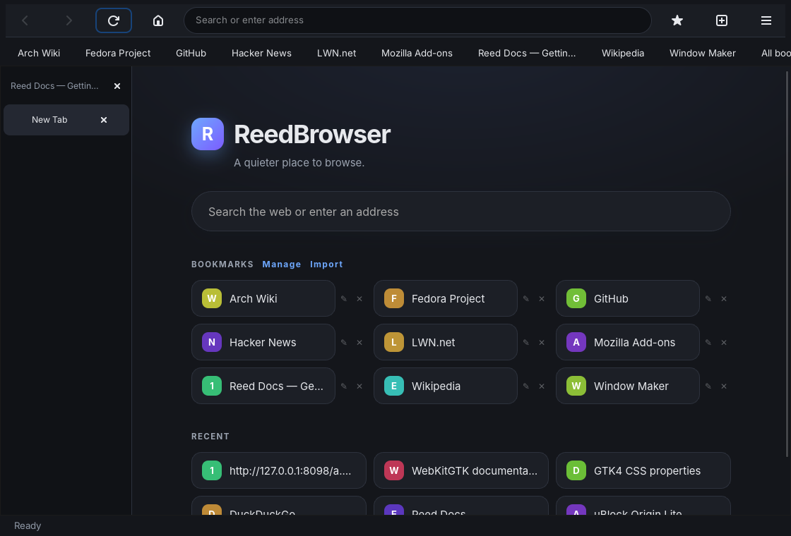
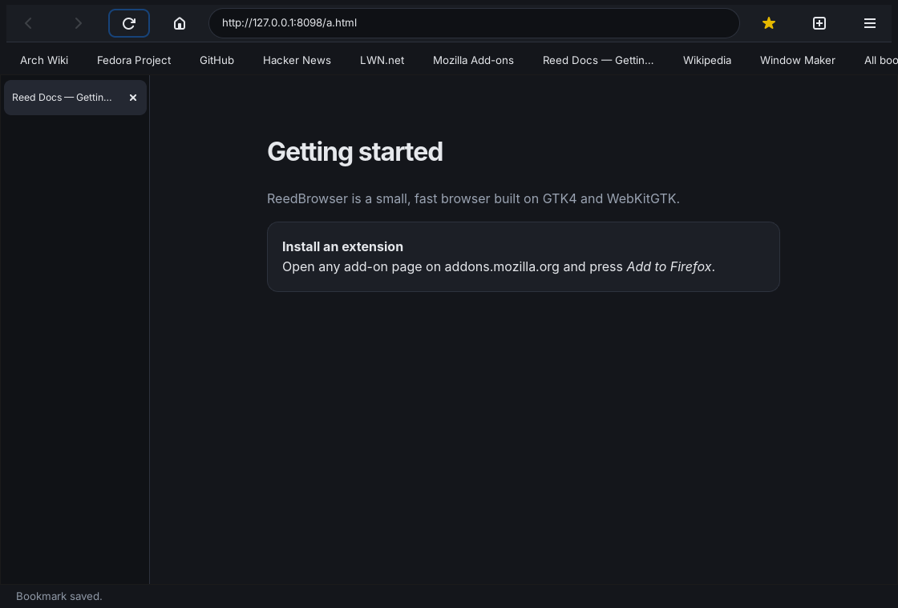
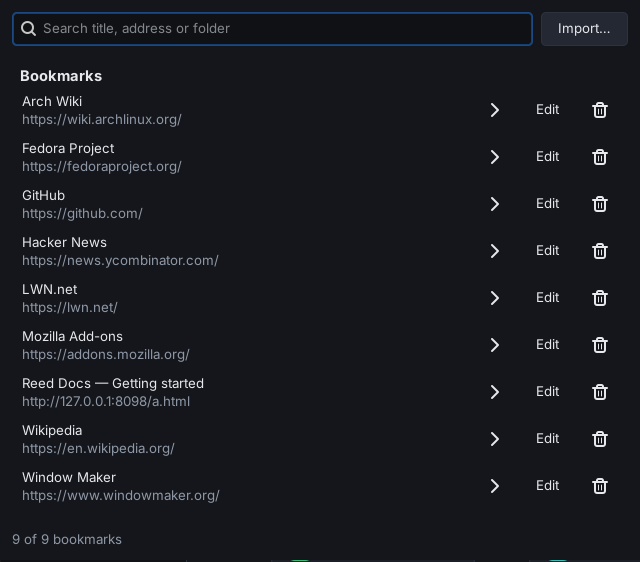

<h1 align="center">ReedBrowser</h1>
<p align="center"><b>A small, quiet Linux browser built on GTK 4 and WebKitGTK 6.0.</b><br>
Vertical tabs, a dark UI, Firefox add-on support, and a footprint that suits modest hardware.</p>

<p align="center"></p>

<table>
<tr>
<td width="50%"><br><sub>Vertical tabs, bookmarks bar, starred page</sub></td>
<td width="50%"><br><sub>Bookmark manager with search, edit and import</sub></td>
</tr>
</table>

## Highlights

- **Native and light.** One WebKit view per tab inside a GTK4 window. Normal tabs share a persistent session, and private tabs use an ephemeral one. WebKit decides how renderer processes are shared.
- **Dark by design.** A custom dark theme covers the toolbar, tabs, menus, dialogs and the new-tab page. Light and system themes, accent colours and UI density are in Settings.
- **Bookmarks that behave.** Star a page with Ctrl+D, show a bookmarks bar with Ctrl+Shift+B, and edit, remove, search and organise in the manager (Ctrl+Shift+O). Import from Firefox, Chrome, Chromium or Brave, or from an exported HTML file.
- **Firefox add-ons.** Install from addons.mozilla.org with the *Add to Firefox* button, or from the command line. See [docs/EXTENSIONS.md](docs/EXTENSIONS.md) for exactly what is supported.
- **Everyday tools.** History (Ctrl+H), downloads (Ctrl+J), find in page, zoom, print, view source, full screen, reopen closed tab, and session restore.
- **Privacy defaults.** Intelligent Tracking Prevention, a built-in tracker list, a local-only new-tab page, and site permission requests denied by default.

## Firefox extensions

ReedBrowser has its own WebExtensions runtime on top of WebKitGTK. Install from an add-on page on addons.mozilla.org, or from the command line:

    reedbrowser --install-extension https://addons.mozilla.org/firefox/addon/ublock-origin-lite/
    reedbrowser --install-extension /path/to/addon.xpi
    reedbrowser --list-extensions
    reedbrowser --remove-extension <id-or-name>

Working today: background pages and scripts, content scripts and CSS, popups, options pages and toolbar buttons, `runtime` messaging and ports, `storage`, `tabs`, `scripting`, `declarativeNetRequest` (static and dynamic rules), `cookies`, `webNavigation`, observe-only `webRequest`, `i18n` and `alarms`.

Not supported: blocking `webRequest` (so uBlock Origin's older Manifest V2 build cannot block; use **uBlock Origin Lite**), native messaging, extension context menus and keyboard commands, and per-permission prompts. Nothing here is guaranteed to work with every add-on; Proton Pass in particular is untested. Details are in [docs/EXTENSIONS.md](docs/EXTENSIONS.md).

## Implemented in this source build

- Native GTK4 window and WebKitGTK 6.0 views (no offscreen capture or FLTK).
- Left-side vertical tabs, close buttons, tab reordering, popup/new-window links opening in tabs.
- Shared persistent session for normal tabs; one ephemeral session shared by private tabs; it is discarded after the last private tab closes.
- Lazy loading of restored background tabs: their WebViews are created but navigation starts when selected.
- Back, forward, reload, stop, home, address/search bar.
- Local-only new-tab page. It makes no requests until the user submits a search or opens a bookmark.
- SQLite bookmarks, history, recent pages, and session restore.
- Download destination handling to the user's Downloads directory.
- Find in page with live match count, zoom controls, common keyboard shortcuts.
- WebKit Intelligent Tracking Prevention (ITP).
- Compiled WebKit content filter with a small built-in tracker/ad-domain starter list.
- Site permission requests are denied by default in this first build.
- Fedora RPM spec and desktop integration.

## Fedora 45 build

Install dependencies:

```bash
sudo dnf install gcc-c++ cmake make pkgconf-pkg-config gtk4-devel webkitgtk6.0-devel sqlite-devel json-glib-devel libarchive-devel libcurl-devel
```

Build:

```bash
./build.sh
```

Run:

```bash
./build/reedbrowser
```

Install locally:

```bash
sudo cmake --install build --prefix /usr/local
```

The build script defaults to two parallel jobs to avoid exhausting low-memory machines. Override with `JOBS=1` or `JOBS=3` if needed.

## Fedora RPM

From the project root:

```bash
mkdir -p ~/rpmbuild/SOURCES
 tar -czf ~/rpmbuild/SOURCES/reedbrowser-0.5.1.tar.gz --transform 's,^,reedbrowser-0.5.1/,' . --exclude=./build --exclude=./.git
rpmbuild -ba packaging/reedbrowser.spec
```

## Data locations

- Profile/database: `~/.local/share/reedbrowser/`
- WebKit cache: `~/.cache/reedbrowser/`
- Downloads: the XDG Downloads directory, falling back to `~/Downloads`

## Shortcuts

| Shortcut | Action |
|---|---|
| Ctrl+T | New tab |
| Ctrl+W | Close tab |
| Ctrl+Shift+N | New private tab |
| Ctrl+Shift+T | Reopen closed tab |
| Ctrl+Shift+O | Bookmark manager |
| Ctrl+Shift+B | Show/hide bookmarks bar |
| Ctrl+H | History |
| Ctrl+J | Downloads |
| Ctrl+P | Print |
| Ctrl+U | View page source |
| F11 | Full screen |
| Ctrl+L / F6 | Focus address bar |
| Ctrl+R / F5 | Reload |
| Alt+Left / Alt+Right | Back / forward |
| Ctrl+Tab / Ctrl+Shift+Tab | Next / previous tab |
| Ctrl+D | Bookmark current page |
| Ctrl+F | Find in page (type to search, Enter / Ctrl+G next, Ctrl+Shift+G previous) |
| Ctrl++ / Ctrl+- / Ctrl+0 | Zoom in / out / reset |
| Esc | Stop loading / close find bar |

## Current limitations — please test before relying on it

This is an early development build, not a finished browser release. As of 0.5.1 it **compiles cleanly and has been run and driven end to end** (Ubuntu 24.04, GTK 4.14, WebKitGTK 2.52, under Xvfb). It has **not** yet been built or run on Fedora 45, and not on real hardware with GPU/video. See `BUILD-STATUS.md` for exactly what was and was not tested.

- The built-in filter is a starter list, not EasyList/uBlock Origin-class filtering.
- Firefox WebExtensions are not implemented. Epiphany's extension code is a possible future donor/reference, but its current extension support is experimental and tightly integrated with Epiphany.
- Password manager, autofill, sync, extension UI, permissions UI, print UI, and downloads manager window are not implemented yet.
- Private tabs are ephemeral, but their existence is visible in the current browser window and they share the same browser UI process.
- Permission prompts are denied rather than shown in a permission manager.
- Media playback and hardware acceleration depend on the Fedora WebKitGTK/GStreamer/Mesa stack and must be tested on the Radeon 610M laptop.
- No performance claims are made until startup, memory, CPU, tab switching, and video playback are measured on the target machine.

## Epiphany source use

The uploaded Epiphany source was inspected as an architectural reference, especially its tab/WebKit integration, browser session model, downloads, history, and extension subsystem. This 0.4.0 implementation does **not** copy Epiphany source files. It uses the public WebKitGTK API and the existing ReedBrowser AGPL-3.0-only project license.

## License

GNU Affero General Public License version 3 only (`AGPL-3.0-only`). See `LICENSE`.

## Settings and appearance

Open the application menu at the right end of the navigation toolbar and select **Settings & extensions**. The settings window includes an Appearance page with a persistent dark-mode toggle, an Extensions page for viewing/installing/removing extensions, and an About page. See [Settings UI](docs/SETTINGS-UI.md) for current behavior and limitations.

